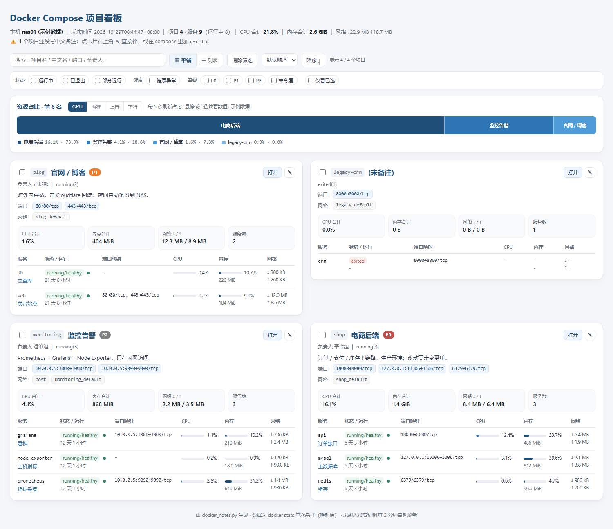

# docker-notes

> 给每个 Docker Compose 项目写一句**中文备注**，然后把**端口、CPU、内存、网络、运行状态**汇总成一张可搜索的看板。
>
> 备注写在 compose 文件里（`labels` + `x-note`），跟着项目走，不用另建一份文档。

[](https://github.com/benjiamin311/docker-notes-repo/actions/workflows/docker.yml)
[](https://github.com/benjiamin311/docker-notes-repo/pkgs/container/docker-notes-repo)



---

## 特性

- **备注即代码**：`note.name` / `note.desc` / `note.owner` / `note.tier` 写在 `labels:` 里；项目级备注写在顶层 `x-note:`（compose 会忽略 `x-` 键，不影响启动）。
- **一张卡片看全**：端口映射（含 `127.0.0.1:` 与 host 网络）、CPU、内存、网络收发、容器状态/健康/运行时长、内部网络与 IP。
- **自动刷新**：容器内每 `REFRESH_SECONDS` 秒采集一次；页面在未输入搜索词时每 2 分钟自动重载。采集失败会保留上次快照，并在页面顶部横幅提示原因。
- **可搜索**：按项目名 / 中文名 / 端口 / 负责人实时过滤。
- **顺带可观测**：`/metrics` 输出 Prometheus 指标，`/healthz` 供探活，`/api/inventory.json` 给自动化用。
- **两种权限模型**：简单版直接挂 `docker.sock:ro`；加固版经 `docker-socket-proxy` 只放行只读 API。
- **单文件、零第三方依赖**：核心只有一个 `docker_notes.py`（Python 标准库）；镜像基于 Alpine，支持 amd64 / arm64。

---

## 快速开始

### 方式 A：docker run

```bash
docker run -d --name docker-notes \
  --restart unless-stopped \
  -p 8080:8080 \
  -v /var/run/docker.sock:/var/run/docker.sock:ro \
  -v /opt:/mnt/host-compose:ro \
  -e PATH_MAP=/opt:/mnt/host-compose \
  -e REFRESH_SECONDS=300 \
  -e TZ=Asia/Shanghai \
  ghcr.io/benjiamin311/docker-notes-repo:latest
```

打开 `http://<宿主机IP>:8080`。

> 只挂 `docker.sock` 也能看到**服务级**中文备注；再挂 compose 目录才能读到**项目级** `x-note`。

### 方式 B：docker compose（推荐）

```bash
curl -O https://raw.githubusercontent.com/benjiamin311/docker-notes-repo/main/docker-compose.yml
curl -O https://raw.githubusercontent.com/benjiamin311/docker-notes-repo/main/.env.example
mv .env.example .env      # 改 IMAGE / COMPOSE_DIR / BASIC_AUTH
docker compose up -d
docker compose logs -f    # 看到「docker-notes 已启动」即可
```

**加固版**（不给看板容器 docker.sock，经只读代理）：

```bash
docker compose -f docker-compose.hardened.yml up -d
```

---

## 参数

| 环境变量 | 默认值 | 说明 |
|---|---|---|
| `REFRESH_SECONDS` | `300` | 采集间隔（秒），最小 10 |
| `PORT` | `8080` | 容器内监听端口 |
| `BIND` | `0.0.0.0` | 监听地址 |
| `BASIC_AUTH` | 空 | `user:pass`，设置后整个站点启用 HTTP Basic 认证 |
| `PATH_MAP` | 空 | `宿主机路径:容器路径[;…]`，把 compose 文件路径映射到只读挂载点，用于读 `x-note` |
| `DOCKER_HOST` | 空 | 走 socket-proxy 时设为 `tcp://socket-proxy:2375` |
| `TZ` | `Asia/Shanghai` | 容器时区 |

命令行等价参数：`serve --port 8080 --refresh 300 --path-map /opt:/mnt/host-compose --basic-auth u:p`。

---

## 给 compose 项目加中文备注

完整示例见 [`compose-labels.example.yml`](compose-labels.example.yml)。

```yaml
x-note:                          # 项目级（顶层，compose 忽略 x- 键）
  name: "电商后端"
  desc: "订单 / 支付 / 库存主链路，生产环境；改动需走变更单。"
  owner: "平台组"
  tier: "P0"                     # P0 核心 / P1 重要 / P2 一般
  url: "https://shop.example.com"

services:
  api:
    image: example/shop-api:1.4.2
    ports:
      - "18080:8080"
    labels:
      note.name: "订单接口"
      note.desc: "对外下单主链路，读写 MySQL 与 Redis"
      note.owner: "张伟"
      note.tier: "P0"
```

| 字段 | 位置 | 说明 |
|---|---|---|
| `name` | `x-note` / `note.name` | 中文名；不写会显示「未备注」并在页面顶部提示 |
| `desc` | 同上 | 一句话说明（是什么 + 关键约束） |
| `owner` | 同上 | 负责团队 / 负责人 |
| `tier` | 同上 | `P0` / `P1` / `P2`，彩色徽章 |
| `url` | 同上 | 访问入口 |
| `note.backup` | 仅服务级 | 备份说明 |

改完 **`docker compose up -d` 重建容器**，labels 才会写进容器；只改 `x-note` 则下次采集即生效（直接读文件）。

---

## HTTP 端点

| 路径 | 说明 |
|---|---|
| `/` | 看板页面（HTML） |
| `/api/inventory.json` | 完整采集数据（JSON），便于二次开发 / 导入 Excel |
| `/healthz` | 探活：`{"ok":true,"age_seconds":12,"projects":4}`；采集失败返回 503 |
| `/metrics` | Prometheus 指标：项目 CPU / 内存 / 网络 / 服务数 / 采集状态 |

---

## 镜像（GHCR）

本仓库镜像，**公开可直接拉取**，支持 amd64 / arm64：

```
ghcr.io/benjiamin311/docker-notes-repo:latest
```

[`.github/workflows/docker.yml`](.github/workflows/docker.yml) 在每次推送到 `main` 时自动执行：单元测试 → 构建双架构镜像 → 推送 GHCR；打 `v*` 标签会额外生成 `1.0.0` / `1.0` 版本标签，每次提交另有一个 `sha-<短哈希>` 标签便于回滚。

换成自己的账号：改 `.env` 里的 `IMAGE`（以及 workflow 里 `env.IMAGE`，默认已取 `github.repository`，一般不用动）。

> 如果包变成私有：仓库 → **Packages** → `docker-notes-repo` → **Package settings** → 可见性改成 **Public**；否则宿主机需要先 `docker login ghcr.io`。

---

## 命令行模式（不在容器里跑）

同一份脚本也能当纯 CLI 用，适合一次性导出 Markdown / 终端表格：

```bash
python3 docker_notes.py demo                                  # 示例数据 + 渲染
python3 docker_notes.py collect -o inventory.json --render    # 采集并渲染
python3 docker_notes.py render inventory.json --out-dir out   # 离线渲染
python3 docker_notes.py table inventory.json                  # 终端表格
python3 docker_notes.py serve --port 8080                     # 常驻服务
```

产物：`out/inventory.html`、`out/inventory.md`。

---

## 本地开发

```bash
git clone https://github.com/benjiamin311/docker-notes-repo.git
cd docker-notes
python -m unittest discover -s tests -v      # 10 个用例，不需要 docker
python docker_notes.py demo                  # 看效果
docker build -t docker-notes:dev . && docker run --rm docker-notes:dev demo --out-dir /tmp/out
```

目录结构：

```
docker_notes.py              # 采集 + 渲染 + Web 服务（标准库）
tests/test_smoke.py          # 渲染 / 端口解析 / 路由 / 认证
Dockerfile                   # python:3.12-alpine + docker-cli + compose 插件
docker-compose.yml           # 简单部署
docker-compose.hardened.yml  # 经 socket-proxy 的只读部署
.github/workflows/docker.yml # 测试 + 多架构构建推送
```

---

## 安全提示

- `docker.sock` 的访问权限**等价于宿主机 root**。`:ro` 只是挂载属性，不能限制 Docker API 的写操作。对外暴露前请：
  - 至少开 `BASIC_AUTH`，并且只在内网/VPN 访问；
  - 或直接用 `docker-compose.hardened.yml`（socket-proxy 只放行 GET 类只读端点）。
- 容器默认以 root 运行（需要读 docker socket）。若你的环境要求非 root，可在 compose 里加 `user: "1000:$(getent group docker | cut -d: -f3)"`。
- 看板会展示容器内网 IP、端口与负责人信息，**不要直接暴露到公网**。

---

## 数据口径与限制

| 项 | 来源 | 说明 |
|---|---|---|
| 项目列表 | `docker compose ls --all --format json` | 老版本 compose 自动退回解析表格 |
| 端口 | `docker inspect` → `NetworkSettings.Ports` | 只 `expose` 未 `publish` 显示 `-`；`network_mode: host` 显示「host 网络」 |
| CPU / 内存 / 网络 | `docker stats --no-stream` | **单次采样瞬时值**；CPU% 为占单核百分比，多核可 >100%；网络是容器累计值，重启清零 |
| 运行时长 | `State.StartedAt` | 仅对 running 有意义 |
| 项目级备注 | compose 文件 `x-note` | 需要把 compose 目录挂进容器（`PATH_MAP`） |

定位是**清单 / 交接 / 巡检快照**；需要历史曲线请上 Prometheus + Grafana（`/metrics` 已经可以接）。

---

## FAQ

| 现象 | 处理 |
|---|---|
| 页面显示「正在启动 / 采集失败」 | 看容器日志；多半是没挂 `docker.sock` 或权限不足（`docker ps` 在宿主机能用吗） |
| 全部显示「未备注」 | 只写了 `labels:` 没重建容器；或项目级 `x-note` 没挂载 compose 目录（检查 `PATH_MAP`） |
| 端口一栏是 `-` | 容器只 `expose` 未 `publish`（内网服务，正常） |
| 群晖 / 威联通 | 用 Container Manager 的「项目」导入 `docker-compose.yml`；compose 目录一般是 `/volume1/docker`，记得同步改 `PATH_MAP` |
| 想改配色 | `docker_notes.py` 里 `HTML_HEAD` 的 CSS 变量 `--brand/--brand2` |
| 想加字段（如变更单号） | `NOTE_KEYS` 加键 + compose 加 `note.xxx` + 卡片模板加一行 |

---

## License

[MIT](LICENSE)
